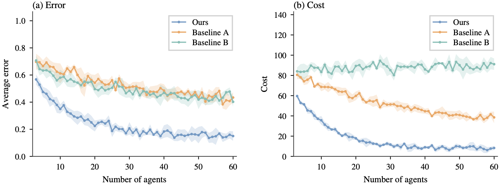
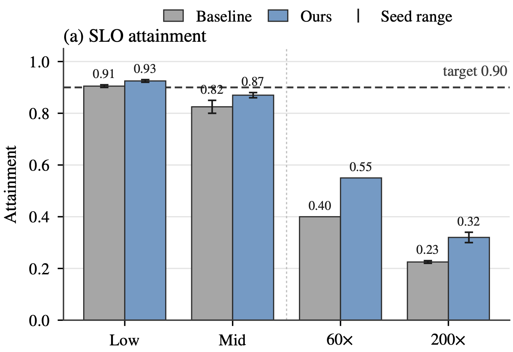

# academic-figure-skill

A Claude skill for IEEE-style academic paper figures in matplotlib: STIX serif fonts at 7–8 pt, column-width sizes, a colorblind-checked soft palette (gray baseline / blue method), outlined bars, min–max seed whiskers, line plots with shaded uncertainty bands, and vector PDF output.

## Examples

All examples use synthetic data.

**Lines with shaded uncertainty bands** (`example_lines.py`)



**Grouped bars with seed-range whiskers** (`example.py`)



## Contents

| File | Purpose |
|---|---|
| `SKILL.md` | Instructions Claude follows: fonts, sizes, colors, annotations, legend placement |
| `paper_style.py` | Importable style module (`PAPER_RC`, colors, sizes, helper functions) |
| `example.py` | Grouped-bar reference figure: `python3 example.py <output_dir>` |
| `example_lines.py` | Line + band reference figure: `python3 example_lines.py <output_dir>` |

## Install

**Claude Code**

```bash
git clone https://github.com/liuhao030922/academic-figure-skill.git ~/.claude/skills/paper-figures
```

Then ask for "paper-style figures" or run `/paper-figures`.

**Claude app (claude.ai)**

Zip the folder and upload it under Customize → Skills → Add.

## Use without Claude

```python
import sys; sys.path.insert(0, "path/to/academic-figure-skill")
from paper_style import *

with plt.rc_context(PAPER_RC):
    fig, ax = plt.subplots(figsize=SINGLE_COLUMN)
    ax.bar([0, 1], [0.8, 0.9], 0.5, **bar_style(METHOD))
    paper_axis(ax)
    save_paper(fig, "figure")  # writes figure.pdf
```

## Palette

| Role | Hex |
|---|---|
| Baseline | `#a6a6a6` |
| Proposed method | `#6b9bc8` |
| Good / met | `#79c0b6` |
| Warning / minor | `#f4a65c` |
| Neutral | `#b3b3b3` |
| Bad / failed | `#ec7f7c` |
| Outline | `#2b2b2b` |
