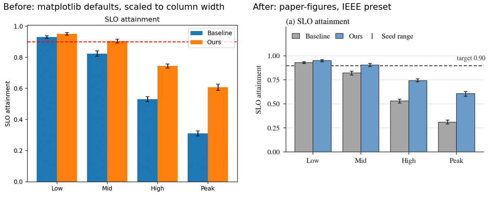
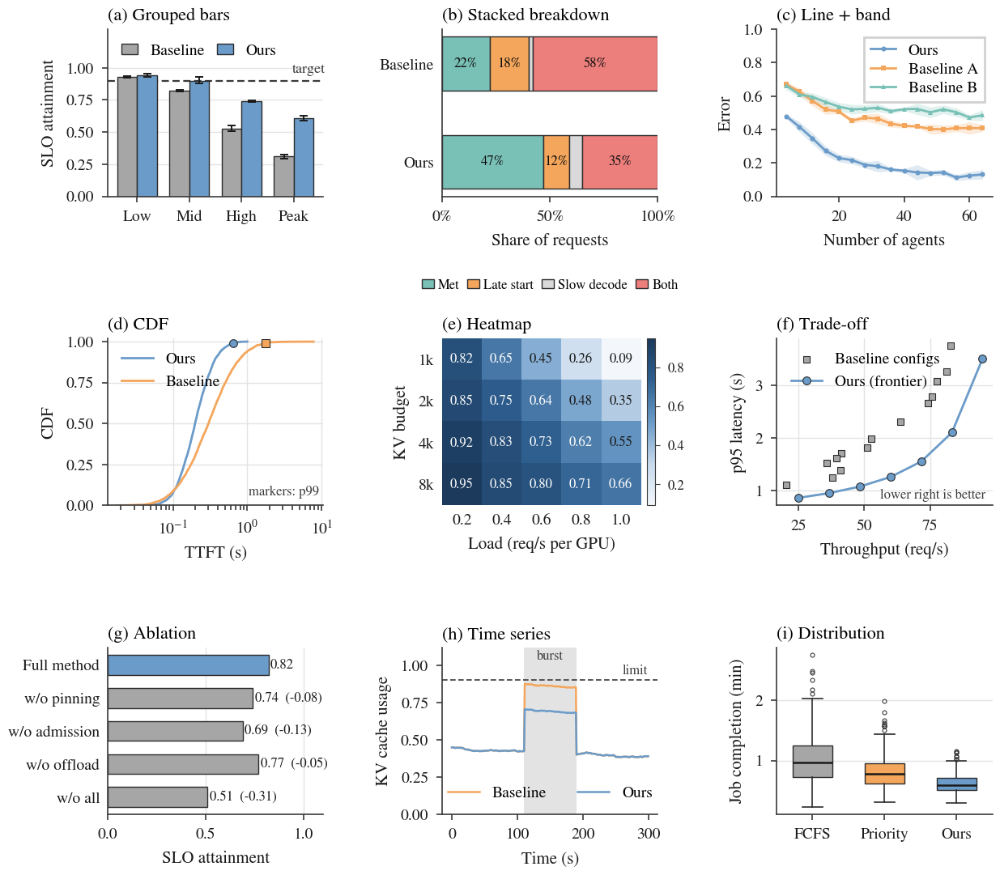
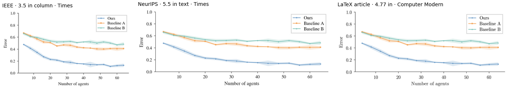
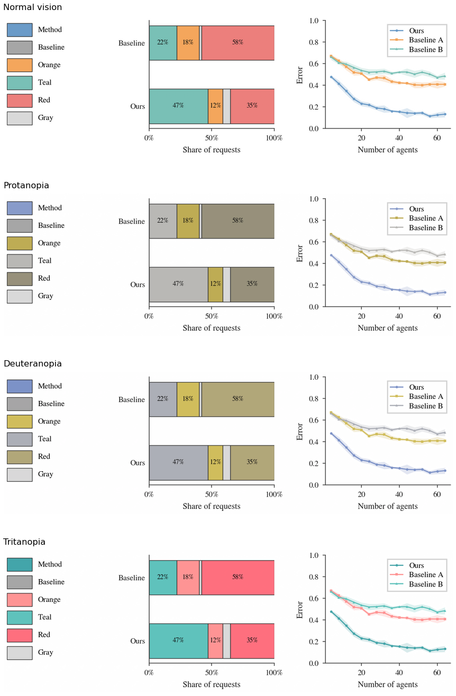

# Academic Figure Skill

[English](README.md) | **简体中文**

[](LICENSE)
[](https://github.com/liuhao030922/academic-figure-skill/actions/workflows/ci.yml)


一个 **Claude skill**，专门画能直接放进论文的 matplotlib 图。
告诉 Claude 你要画什么，它会选合适的图表类型、按会议模板设定栏宽、使用面向会议的衬线字体回退，并在交付前检查结果。
不用 Claude 时，也可以当作普通的 Python 样式模块使用。



## 图库

覆盖大多数系统 / 机器学习论文的九种图表。每张子图都对应
[`examples/gallery.py`](examples/gallery.py) 里的一个 `draw_*` 函数，可以直接复制使用。所有数据都是合成的。



## 和只用样式文件有什么区别？

| | 只用样式文件（如 SciencePlots） | 本 skill |
|---|---|---|
| 按会议设定字体字号 | ✓ | ✓ IEEE · ACM · USENIX · ICML · NeurIPS · article |
| 按会议设定的单栏 / 双栏宽度 | — | ✓ `figsize("column", 2.2)` |
| 选图建议 | — | ✓ 什么数据用什么图，哪些图不要用 |
| 科研常用图的辅助函数 | — | ✓ 种子误差须、误差带、CDF p99、带数值热力图 |
| 交付前检查 | — | ✓ Claude 会渲染出来检查遮挡和裁切 |
| 数据安全 | — | ✓ 不会把未发表的实验结果放进公开示例 |

## 直接问 Claude

装好之后，用自然语言描述你要的图就行，Claude 会自动调用这个 skill。

> **"我的论文用 IEEEtran。用 `results.csv` 画 FCFS 和我们方法在四个负载下的 SLO 达成率，每组三个种子。"**
>
> → 3.45 英寸宽的分组柱状图，baseline 灰、方法蓝，种子最小–最大误差须，虚线目标线，输出 PDF，可直接 `\includegraphics[width=\columnwidth]`。效果类似上图 (a)。

> **"给这篇 NeurIPS 论文画三个调度器的延迟 CDF，标出 p99。"**
>
> → NeurIPS 宽度、Times 字体、对数横轴的 CDF，标 p99 点，每条线用不同形状的标记。效果类似 (d)。

> **"这是我的消融实验表，帮我做成 ACM 投稿用的图。"**
>
> → 带"相对完整方法差值"的消融柱状图，Libertine 字体，按 `acmart` sigconf 尺寸。效果类似 (g)。

也可以输入 `/paper-figures` 手动调用。

## 安装

**Claude Code**

```bash
git clone https://github.com/liuhao030922/academic-figure-skill.git ~/.claude/skills/paper-figures
```

**Claude app（claude.ai）**：clone 或下载仓库，先生成目录名正确的 skill
压缩包，再从 Plugins/Customize → Skills 上传 `dist/paper-figures.zip`：

```bash
python3 tools/package_skill.py
```

生成的 ZIP 顶层目录是与 skill 名称一致的 `paper-figures/`，符合自定义
skill 上传器的结构要求。

**Codex**

```bash
git clone https://github.com/liuhao030922/academic-figure-skill.git ~/.codex/skills/paper-figures
```

**纯 matplotlib（不用 Claude）**

先安装运行依赖：

```bash
python3 -m pip install -r requirements.txt
```

```python
import matplotlib.pyplot as plt
plt.style.use("path/to/academic-figure-skill/styles/ieee.mplstyle")
```

或者使用辅助函数：

```python
import sys; sys.path.insert(0, "path/to/academic-figure-skill")
from paper_style import *

use_venue("ieee")
fig, ax = plt.subplots(figsize=figsize("column", 2.2))
ax.bar([0, 1], [0.8, 0.9], 0.5, **bar_style(METHOD))
paper_axis(ax)
save_paper(fig, "figure")  # 输出 figure.pdf
```

## 会议模板

| 模板 | 单栏宽 | 正文宽 | 字体 |
|---|---|---|---|
| `ieee` | 3.50 in | 7.16 in | Times（STIX） |
| `acm` | 3.33 in | 7.00 in | Linux Libertine* |
| `usenix` | 3.33 in | 7.00 in | Times（STIX） |
| `icml` | 3.25 in | 6.75 in | Times（STIX） |
| `neurips` | 5.50 in | 5.50 in | Times（STIX） |
| `article` | 4.77 in | 4.77 in | Computer Modern |

\* 没装 Libertine / Libertinus 字体时会退回 Times。

同一张图在三种模板下的效果（按真实相对尺寸显示）：



## 配色与色盲检查

| 用途 | 颜色 | 色值 |
|---|---|---|
| 你的方法 |  | `#6b9bc8` |
| Baseline |  | `#a6a6a6` |
| 好 / 达成 |  | `#79c0b6` |
| 警告 |  | `#f4a65c` |
| 中性 |  | `#d9d9d9` |
| 差 / 失败 |  | `#ec7f7c` |

这套配色故意偏柔和，代价是颜色之间的区分度低一些。所以这里不写"色盲安全"，而是直接给出实测数据
（OKLab ΔE × 100，取红色盲 / 绿色盲 / 蓝色盲模拟下最难区分的一对；≥ 8 比较稳，6–8 需要额外的区分手段）：

| 一起出现的颜色 | 最难区分的一对 | 色盲下最小 ΔE | 内置的第二区分手段 |
|---|---|---|---|
| 方法 vs. baseline 柱子 | 蓝 / 灰 | 7.8（红色盲） | 描边、位置、图例 |
| 折线（方法、橙、青绿） | 蓝 / 青绿 | 8.9（蓝色盲） | 不同形状的标记 |
| 堆叠结果（青绿、橙、灰、红） | 橙 / 红 | 7.6（蓝色盲） | 段内百分比标签、描边 |

由此得出一条规则：**青绿和 baseline 灰不能出现在同一张图里**（绿色盲下 ΔE 只有 3.2）。skill 里已经写明了这条。
下图模拟了各种色觉下看到的效果（Machado et al., 2009）：



运行 `python3 tools/validate_palette.py` 可以复现表中的数值。

## 仓库结构

```
SKILL.md              Claude 遵循的规则
paper_style.py        样式模块：会议模板、配色、辅助函数
styles/*.mplstyle     plt.style.use() 用的预设
examples/             bars.py、lines.py、gallery.py（全部合成数据）
tools/build_assets.py 重新生成 README 里的所有图片
tools/validate_palette.py 复现配色色差测量
tools/package_skill.py 生成可直接上传的 `paper-figures.zip`
tests/                样式、图表、输出与打包的可执行烟雾测试
.github/workflows/    Python 3.9 / 3.11 / 3.13 CI
```

重新生成图片：`python3 tools/build_assets.py`。

在本地运行完整检查：

```bash
python3 -m unittest discover -s tests -v
python3 tools/build_assets.py
```

会议宽度是常见模板下的实用默认值。如果会议模板或文档类使用了特殊选项，
投稿前请以 LaTeX 实际的 `\columnwidth` 或 `\textwidth` 为准。

## 许可证

[MIT](LICENSE)
